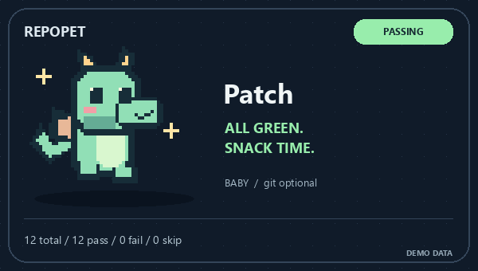
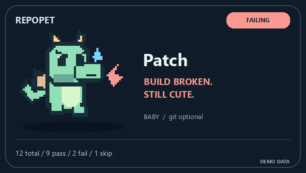

<p align="center"></p>

# RepoPet 🐉 Your repo has feelings.

**Give your README a tiny dragon. Let your test results decide its mood.**

[中文](README.md) · [Five-mood playground](https://l422145205-source.github.io/showcase-skills/) · [Agent Skill](SKILL.md) · [CI recipe](references/evidence.md)


## Another green check. This time, someone celebrates.

Meet Patch. It does a happy dance when tests pass, throws a tiny tantrum when a build breaks, and takes a nap when everything is skipped. If no test signal arrives, it simply looks confused. Relatable.

RepoPet is an installable **Agent Skill**. Ask your Agent to read an existing test/workflow result, render the original pixel dragon and place the GIF in your README. For the care of actual cats and dogs, see the separate [PetLife Skill](https://github.com/l422145205-source/pet-life).

```sh
npx skills add l422145205-source/repo-pet
```

Then ask:

> Use `$repo-pet` to give this repository a mint dragon named Patch. Use the existing JUnit report and add the GIF to README.md. Preserve the rest of the file.

The renderer needs Python 3.10+ and Pillow 10.1+. No additional model calls, GPU or image API key.

## Five moods. One little dragon.

| All green. Snack time. | Build broken. Still cute. | Hold on. Dragon at work. |
| :---: | :---: | :---: |
|  |  |  |

All gallery images are **labeled synthetic previews**, not this repository's CI. [Open all five moods →](https://l422145205-source.github.io/showcase-skills/)

| Signal | Reaction |
| --- | --- |
| Recorded executed passes, no failures/errors | Happy dance |
| Any failure/error, or failed workflow | Tiny tantrum |
| Queued/in-progress workflow | Busy dragon |
| All test cases skipped, or explicitly skipped workflow | Nap time |
| Missing/invalid report, no cases, cancelled/neutral workflow | Just vibes; status unknown |

A successful workflow is labeled CI evidence, not a made-up test count. No report never becomes a green badge. [Exact rules →](references/evidence.md)

## Raise a dragon, one commit at a time


Available local history unlocks **egg (0–2 commits) → baby (3–24) → dragon (25+)**. Cosmetic stages only, not a contribution score. Shallow clones see only fetched history. Outside a Git repository, Patch starts as a baby.

Prefer instant dragon energy? Ask for a stage manually. Choose mint, lilac or peach. The look changes; the evidence does not.

## Take it for a walk before installing

Clone this repository and run in your project environment:

```sh
python -m pip install -r requirements.txt
python scripts/repopet.py demo --out work/repopet-demo
```

Open `work/repopet-demo/passing/pet.gif`. Render for a real project:

```sh
python scripts/repopet.py render --repo ../your-project --junit ../your-project/junit.xml --out ../your-project/assets/repopet --readme ../your-project/README.md
```

You receive `pet.gif`, `pet.png` and `status.json`. These are snapshots: rerun to refresh. The [CI recipe](references/evidence.md) uploads an artifact without granting write permissions or automatically pushing images.

## A small pet with a small footprint

Only aggregate test results and commit counts enter the generated snapshot. No author emails, commit messages, remote URLs or source paths. Choose a public-safe pet name. README updates stay inside the owned marker block and refuse ambiguous markers.

All sprites are original code-drawn artwork. Each generated mood follows the supplied evidence.

Want a new expression, palette or original creature? Bring your idea to [Issues](https://github.com/l422145205-source/repo-pet/issues). If Patch adds a little joy to your README, a **Star** helps the next dragon keeper discover it.

MIT licensed. Checks: `python -m unittest discover -s tests -v`. Rebuild visuals: `python scripts/build_showcase.py`.
