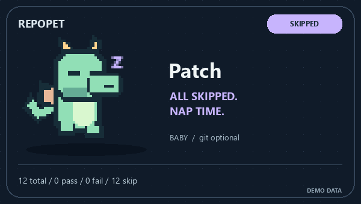
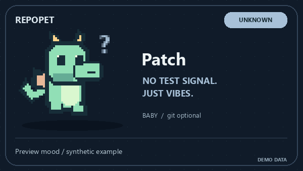

<p align="center"></p>

# RepoPet 🐉 测试一红，小龙就急了

**给 README 养一只会“看测试脸色”的像素小龙。绿灯撒欢，红灯炸毛，全部跳过就原地打盹。**

[English](README.en.md) · [看看五种表情](https://l422145205-source.github.io/showcase-skills/) · [Skill 指令](SKILL.md) · [CI 接法](references/evidence.md)


## 你的仓库很努力，它需要一点表情

写完代码，跑测试，盯着一排绿字。恭喜，又是平平无奇的一次通过。

现在，给这个瞬间加一只 Patch。

测试全绿，它晃尾巴、冒星星：“该吃小零食了。”  
构建失败，它皱眉冒小火花：“我很生气，但我还是很可爱。”  
工作流还在跑，它继续忙活。所有用例跳过？那就先睡一觉。

RepoPet 是装进 Agent 的 **README 宠物 Skill**：Agent 读取已有结果，调用渲染工具，生成真正的 GIF，再按你的要求放进 README。它是仓库吉祥物；真实猫狗的日常照顾请看 [PetLife](https://github.com/l422145205-source/pet-life)。

## 领养 Patch

```sh
npx skills add l422145205-source/repo-pet
```

对 Agent 说：

> 用 `$repo-pet` 给这个仓库养一只薄荷绿小龙，叫 Patch。读取已有的 JUnit 测试报告，把动图加进 README；其他内容保留。

Agent 会找到脚本、检查依赖、生成图片，只更新属于 RepoPet 的标记区。渲染需要 Python 3.10+ 和 Pillow 10.1+，不需要额外模型调用、GPU 或图片 API Key。

## 五种心情，哪一种最像今天的你？

| 绿灯撒欢 | 红灯炸毛 | 小龙忙碌中 |
| :---: | :---: | :---: |
|  |  |  |

| 今天没活，先睡了 | 结果呢？我还没收到 |
| :---: | :---: |
|  |  |

上面全部为明确标注的**合成预览**。给真实仓库生成时，心情由真实 JUnit 用例或工作流状态决定。没有报告就冒问号，不会为了可爱假装全绿。

| 发生什么 | Patch 怎么回应 |
| --- | --- |
| 有实际通过用例，且没有失败/错误 | 开心撒欢 |
| 出现失败/错误，或工作流失败 | 小小破防 |
| 工作流排队或执行中 | 忙碌等待 |
| 所有用例跳过，或工作流明确跳过 | 原地打盹 |
| 报告缺失/损坏、无用例、工作流取消/中立 | 一脸问号 |

## 从一颗蛋，陪仓库慢慢长大


本地可达提交数对应 **蛋（0–2）→ 幼龙（3–24）→ 成龙（25+）**。这只是外观彩蛋，不是贡献质量评分；浅克隆只看得到已获取的历史。

想直接养成龙、换个名字或换个颜色，也可以：

> 用 `$repo-pet` 换成淡紫色成龙，叫 Mochi，测试状态仍按真实报告来。

三种配色：薄荷绿、淡紫、蜜桃。外形可以自由选，测试结果照实显示。

## 不安装 Skill，也能先跑起来看看

克隆本仓库，使用你的项目虚拟环境：

```sh
python -m pip install -r requirements.txt
python scripts/repopet.py demo --out work/repopet-demo
```

打开 `work/repopet-demo/passing/pet.gif`。给自己的项目生成：

```sh
python scripts/repopet.py render --repo ../your-project --junit ../your-project/junit.xml --out ../your-project/assets/repopet --readme ../your-project/README.md
```

每次生成 `pet.gif`、`pet.png` 和 `status.json`。图片是本次读取结果的快照，重新运行才会刷新；想放进现有 CI，可用[这份接入示例](references/evidence.md)，不会自动给工作流添加写权限或提交图片。

## 放进 README，也别把个人资料一起放进去

渲染器只读取汇总测试结果和提交总数，不收集作者邮箱、提交说明、远程地址或源文件路径。名字由你指定，公开演示建议用昵称。README 编辑只动 `repopet:start` / `repopet:end` 之间的内容，模糊标记会停止修改。

像素龙由代码原创绘制。没有随意下载的角色素材，也没有把失败 CI 涂绿的魔法。

## 下一只想养什么？

新的表情、配色、原创生物，欢迎在 [Issues](https://github.com/l422145205-source/repo-pet/issues) 留下想法。Patch 替你破防过的话，给它一个 **Star**，让下一位养龙人找到这里。

MIT 开源。检查：`python -m unittest discover -s tests -v`；重建图库：`python scripts/build_showcase.py`。
